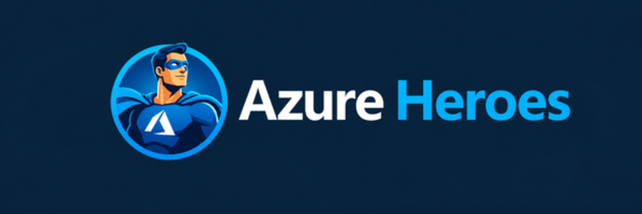
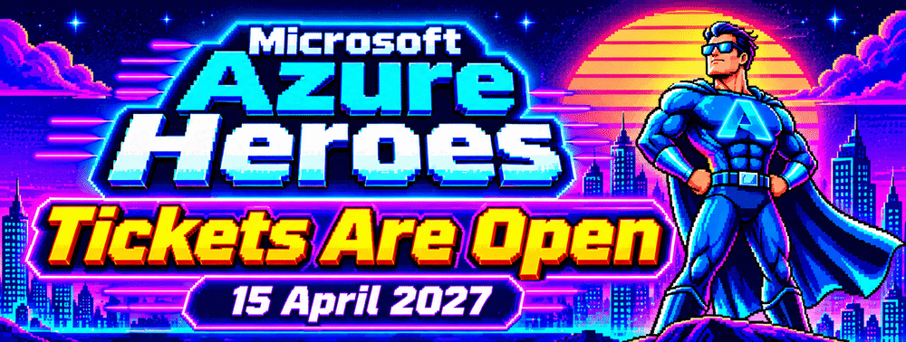
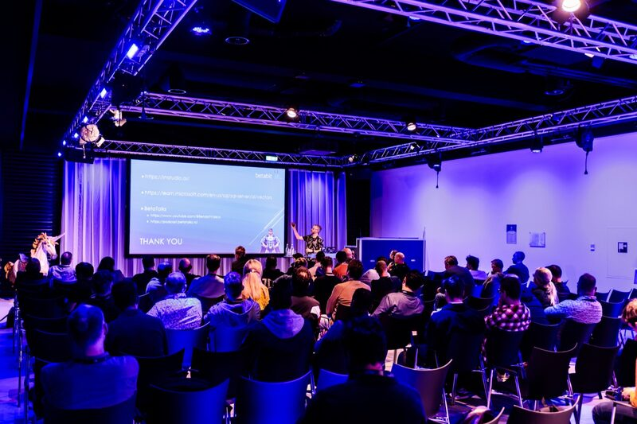
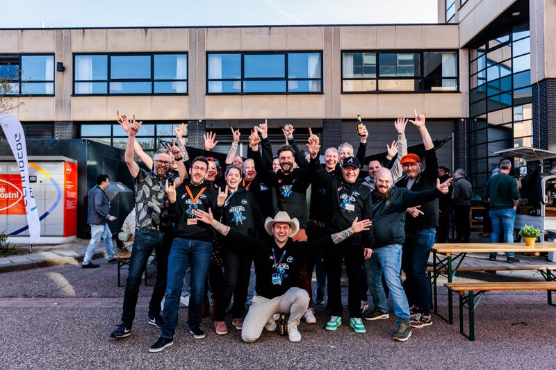
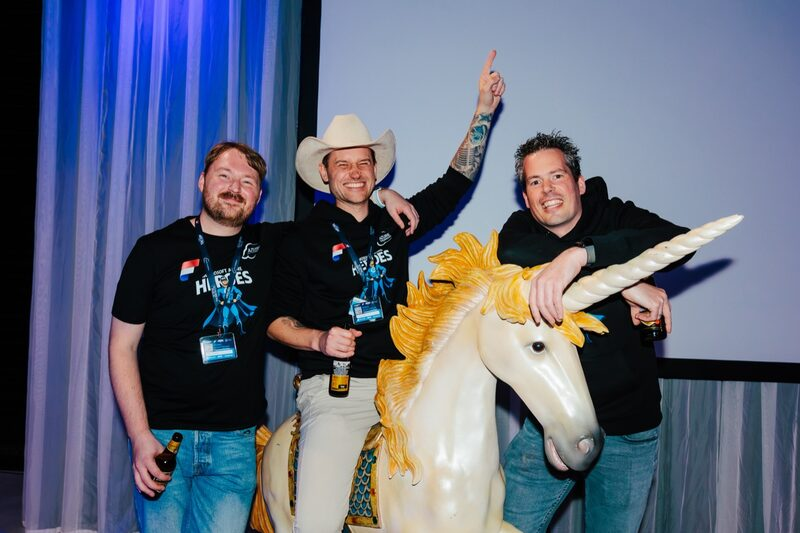

  

<h3 align="center">By community – For community! 🦸☁️</h3>

Free meetups for everyone building on Microsoft Azure: practical sessions from community speakers, 
and plenty of time to learn from each other.

  <a href="https://azureheroes.online">🌐 Website</a> ·
  <a href="https://www.meetup.com/azure-heroes-netherlands/">📅 Meetup</a> ·
  <a href="https://www.linkedin.com/company/azure-heroes">💼 LinkedIn</a> ·
  <a href="https://azureheroes.online/whatsapp-community/">💬 WhatsApp community</a>

---

## 🕹️ PRESS START: Azure Heroes: Retro – The Big One

  

Our biggest day yet: a full day of Microsoft Cloud sessions, discussions and networking, in a retro-superhero setting. Organised by Azure Heroes Netherlands, together with **Azure Thursdays** and the **Dutch Fabric User Group**.

| | |
|---|---|
| 📅 | **Thursday 15 April 2027** |
| 📍 | MARCFAIT, Almere (5 minutes from Almere Centrum station) |
| 👥 | 250–300 cloud engineers, architects, data people and decision makers |
| 🎟️ | **Free ticket**, lunch included → [get yours](https://speakerdesk.eu/events/azure-heroes-2027-1al8/tickets) |
| 🎙️ | Call for speakers, closes 15 December 2026 → [submit a session](https://sessionize.com/azure-heroes-retro/) |
| 🤝 | Sponsor the day → [sponsor packages](https://speakerdesk.eu/events/azure-heroes-2027-1al8/sponsor) |

More: [azureheroes.online/retro](https://azureheroes.online/retro/)

---

## 📸 Global Azure Heroes 2026

  
  
  

Thank you to all speakers, sponsors, volunteers and attendees who made it an incredible celebration of the Azure community. See you in 2027!

---

## 🦸 The team

<table align="center">
  <tr>
    <td align="center"> <b>Danny Kruge</b></td>
    <td align="center"> <b>Maik van der Gaag</b></td>
    <td align="center"> <b>Rogier Dijkman</b></td>
    <td align="center"> <b>Gillian Stravers</b></td>
  </tr>
</table>

<i>Want to speak at a meetup? First-time speakers are very welcome: <a href="https://azureheroes.online/cfp/">submit a talk</a>.</i>

<b>Let's make this the BIG one! 💪☁️</b>

